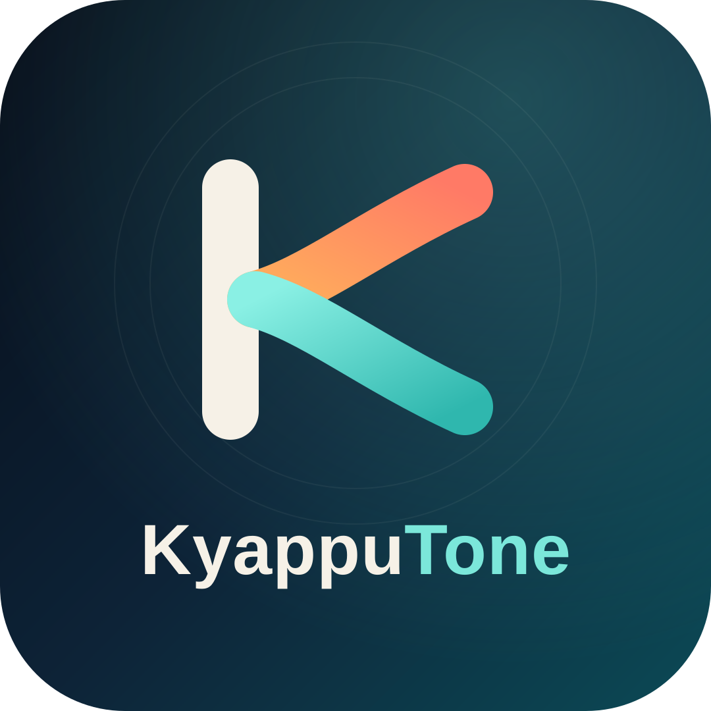

# KyappuTone



KyappuTone is a local-first music player for Windows. It combines a fast library,
synced lyrics, playlists and tagging with Windows media integration, optional online
metadata, internet radio, and a small discovery hub for YouTube audio downloads.

KyappuTone is derived from [Tunetastic](https://github.com/AMit-KP/Tunetastic) and is
licensed under the GNU General Public License v3.0. See `LICENSE` and `NOTICE`.

**Status:** preview, version 0.4.0. Packages are development builds, not
production-signed releases. To try it, build from source (see [Build](#build)) or use the
development-signed package described below.

## Highlights

### Library and playback

- Scan one or more music folders, with duplicate and short-track filtering.
- Browse all songs, artists, albums, genres, years, favorites, folders, and statistics.
- Recently added, recently played, and most played views.
- Smart playlists with artist, genre, year, and minimum-play-count rules.
- Auto playlists generated from the immediate subfolders of each library root.
- Custom playlist covers, drag-and-drop queueing, shuffle, repeat, and sleep timer.
- Synced LRC lyrics with an offset control, plus a full-screen player and visualizer.
- Equalizer, preamp, crossfade, pause/stop fades, and system-volume integration.
- Taskbar transport overlay, tray controls, system media controls, and lock-screen art.

### Metadata

- Find missing album, year, genre, and cover art on MusicBrainz.
- Every lookup shows a before/after preview; nothing is written until you choose Apply.
- Cover art can be fetched separately from the Cover Art Archive.
- Writes go to the audio file with TagLib# and to the local SQLite database.
- Online lookup is opt-in and responses are cached locally for seven days.

### Discover

- **YouTube:** search with yt-dlp and queue audio-only downloads.
- **Downloads:** persistent queue, one download at a time, cancel, retry, and optional
  automatic import into the library.
- **Radio:** search Radio Browser, save favorites, play internet streams, and show the
  current ICY track title in the app and Windows media controls.
- Download tools are installed on demand into the app's local state and verified against
  their published SHA-256 checksums before use.

### Integrations

- **Last.fm:** scrobbling with an offline retry queue, using your own API credentials.
- **Spotify:** playlist import only. Spotify audio is never streamed or downloaded.
- **Discord Rich Presence:** optional now-playing display using your own application ID.
- **GitHub releases:** optional update check against this repository's releases. The app opens
  the release page for a manual install; it never downloads or runs an update silently.

All integrations are opt-in. See `docs/integrations.md` for setup and storage details.

## Requirements

- Windows 10 version 1903 (build 18362) or later, or Windows 11.
- x64 or ARM64. The packaged app is built separately for each architecture.
- To build: [.NET SDK 10.0.402](https://dotnet.microsoft.com/download) or a newer 10.0.x
  SDK. Windows App SDK 2.5.1 and the Windows SDK build tools are restored from NuGet.
- No paid license file and no `sixlabors.lic` are required to build.

## Install a development build

Release artifacts are produced as MSIX packages under `AppPackages\<version>\`. The
repository does not publish production-signed packages.

### Development-signed package

The development certificate is self-signed and is trusted only on machines where it has
been installed.

```powershell
Import-Certificate `
  -FilePath .\KyappuTone-0.4.0-x64-development.cer `
  -CertStoreLocation Cert:\CurrentUser\TrustedPeople
Add-AppxPackage -Path .\KyappuTone-0.4.0-x64-dev-signed.msix
```

For local signature verification with `Get-AuthenticodeSignature`, also import the same
`.cer` into `Cert:\CurrentUser\Root`. Trust the development certificate only on test
machines; a self-signed root trusts anything signed by that key.

For ARM64, use the matching `-ARM64-` files. To uninstall:

```powershell
Get-AppxPackage YoshKoz.KyappuTone | Remove-AppxPackage
```

### Unsigned build for local development

Unsigned MSIX files are useful for inspection and CI, but Windows will not install them
as normal packages. With Developer Mode enabled, register the loose build instead:

```powershell
dotnet build .\KyappuTone.sln -p:Platform=x64 -c Debug -p:AppxPackageSigningEnabled=false
Add-AppxPackage -Register .\bin\x64\Debug\net10.0-windows10.0.26100.0\win-x64\AppxManifest.xml
```

## Build

```powershell
dotnet restore .\KyappuTone.sln
dotnet build .\KyappuTone.sln -p:Platform=x64 -c Debug -p:AppxPackageSigningEnabled=false
```

The app is packaged. Running the loose executable from `bin` requires package identity, so
use the registration command above or run the packaged build from Visual Studio.

## Test

```powershell
dotnet test .\tests\KyappuTone.Core.Tests
```

The audio project also has tests under `tests\KyappuTone.Audio.Tests`. Tone playback and
long-running audio soak tests are intentionally not part of the normal verification loop.

## Package a release

`scripts/package-release.ps1` updates the product and MSIX versions, builds Release for
the requested architecture, and writes a SHA-256 checksum next to the package.

```powershell
# Unsigned package
.\scripts\package-release.ps1 -Platform x64 -Version 0.4.0 -Unsigned

# Self-signed development package (not production-trusted)
.\scripts\package-release.ps1 -Platform x64 -Version 0.4.0 -CreateDevelopmentCertificate

# Real PFX whose subject exactly matches the manifest Publisher
.\scripts\package-release.ps1 -Platform ARM64 -Version 0.4.0 `
  -CertificatePath C:\secure\KyappuTone.pfx `
  -CertificatePassword $env:KYAPPUTONE_CERT_PASSWORD
```

`-CreateDevelopmentCertificate` creates or reuses a certificate for
`CN=KyappuTone Development`, trusts it in `CurrentUser\TrustedPeople`, and stores the
password-protected PFX under `%LOCALAPPDATA%\KyappuTone\Signing`. The script prints a
warning because this certificate is not suitable for public distribution. Details and the
production signing checklist are in `docs/release.md`.

## Configuration

| Integration | Where | What is stored |
| --- | --- | --- |
| Last.fm | Settings → Integrations → Last.fm | API key in local settings; shared secret and session key in Windows Credential Locker; pending scrobbles in SQLite |
| Spotify import | Settings → Integrations → Spotify import | Client ID in settings; PKCE tokens in Windows Credential Locker |
| Metadata lookup | Settings → Integrations → Metadata enrichment | Local lookup cache in SQLite; no account |
| Download tools | Settings → Integrations → Download tools | yt-dlp and FFmpeg in the app's LocalState |
| Discord presence | Settings → Integrations → Discord Rich Presence | Application ID in settings; no token |
| Update checks | Settings → About → Update checks | Optional GitHub token in Windows Credential Locker |

## Privacy

KyappuTone has no telemetry, analytics, or crash upload. Crash logs stay in the app's
local state and are never sent anywhere.

Network access happens only for features you enable or invoke:

- MusicBrainz and the Cover Art Archive during an explicit metadata lookup or cover write.
- GitHub Releases when you run a version check and have stored a token.
- Last.fm and Spotify when you configure and use those integrations.
- Radio Browser and the selected radio stream when you use Radio.
- YouTube through yt-dlp when you search or download.
- Discord over its local IPC socket when presence is enabled.

The music library, playlists, listening history, settings, and caches are stored locally
in SQLite and the app's LocalState. No credentials are bundled with the repository.

## Contributing

Small bug fixes and focused improvements are welcome. Read `CONTRIBUTING.md` before
opening a pull request, keep changes scoped to one feature or fix, and include tests for
logic that can be tested without audio hardware.

For security issues, do not open a public issue. Use the repository's private security
advisory flow as described in `SECURITY.md`.

## Credits

- Upstream: [Tunetastic](https://github.com/AMit-KP/Tunetastic) by AMit-KP and
  contributors, GPLv3.
- Image processing: SkiaSharp (MIT).
- Audio and media plumbing: FlyleafLib and FFmpeg. The FFmpeg DLLs in `Assets/FFmpeg` are a
  GPLv3-enabled build (BtbN FFmpeg-Builds, `N-126175-g0056dd32fd`); see `NOTICE`.
- Metadata: MusicBrainz and the Cover Art Archive.
- Radio directory: Radio Browser.
- Downloads: yt-dlp, with an LGPL FFmpeg build downloaded at runtime (not bundled).

KyappuTone is free software under the GNU General Public License v3.0. See `LICENSE`.
